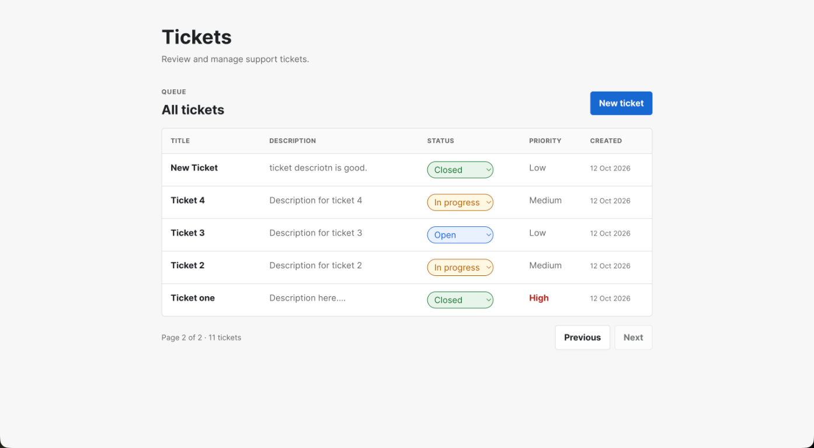

# Mini Ticket Tracker Frontend

React, TypeScript, and Vite frontend for viewing and managing support tickets.

## Setup

Start the Django backend on port `8000`, then install and run the frontend:

```bash
npm install
npm run dev
```

Open `http://localhost:5173`.

The frontend uses `http://127.0.0.1:8000` by default. To use another backend address, add it to `.env`:

```dotenv
VITE_API_URL=http://127.0.0.1:8000
```

The backend must allow `http://localhost:5173` through its CORS configuration.

## Screenshot



## Features

- Responsive ticket table with title, description, status, priority, and creation date
- Client-side pagination with six tickets per page
- Popup form for creating tickets
- Inline status updates using each row's status selector
- Loading, empty, API error, and update error states
- Responsive mobile and desktop layouts

## API usage

The frontend uses these backend endpoints:

| Method | Endpoint | Purpose |
|---|---|---|
| `GET` | `/tickets` | Fetch all paginated ticket results |
| `POST` | `/tickets` | Create a ticket |
| `PATCH` | `/tickets/:id` | Change a ticket's status |

## Validation

```bash
npm run lint
npm run build
```

## Decisions and tradeoffs

The interface uses one responsive page to keep ticket management simple. API calls live in a small typed client rather than adding a data-fetching dependency. The frontend follows every backend result page before applying client-side table pagination. Status changes wait for the API response before updating the row, and failures are shown above the table. The create form uses a modal so users remain within the ticket queue context. Styling uses custom CSS instead of a UI framework. With more time, focus trapping, toast notifications, server-driven table pagination, and end-to-end browser tests could be added.